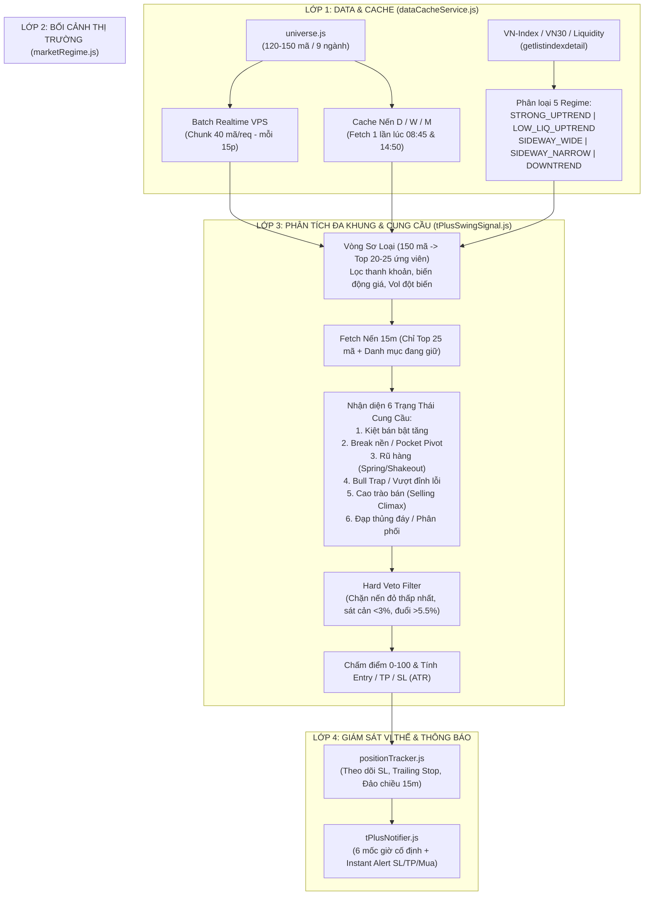
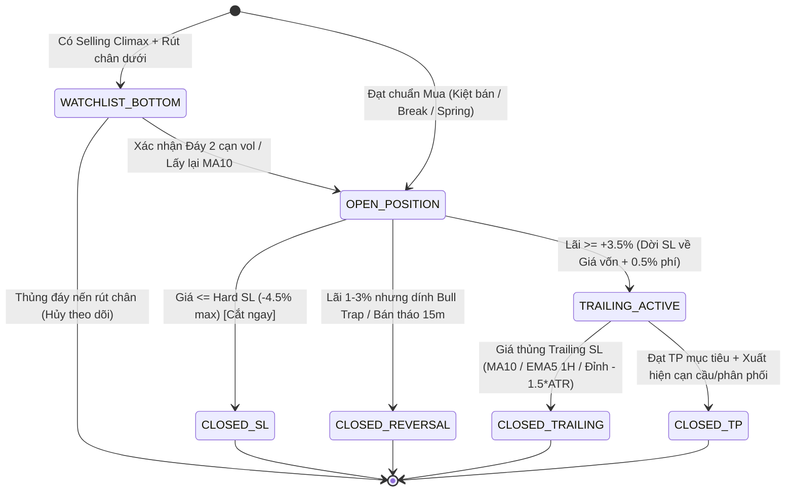
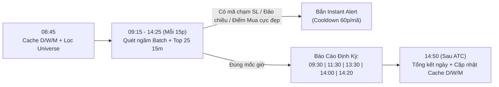

# BẢN KẾ HOẠCH KIẾN TRÚC & TRIỂN KHAI — HỆ THỐNG AI TRADING CƠ SỞ T+ (v1.0)

> **Mục tiêu:** Nâng cấp mảng Chứng khoán Cơ sở trên codebase Node.js hiện tại thành hệ thống quét cung–cầu đa khung thời gian (D/W/M + 15m), tự động hóa nhận diện điểm Mua/Bán/Chốt lời/Cắt lỗ cho giao dịch ngắn hạn **T+ (< 1 tháng)**.  
> **Vũ trụ quét:** 120–150 cổ phiếu đầu ngành & thanh khoản cao (VN30 + Midcap dẫn dắt thuộc 9 nhóm ngành).  
> **Nguyên tắc tối thượng:** *Lạnh lùng, phi cảm xúc. Không có cổ phiếu tốt/xấu — chỉ có Cung, Cầu, Thanh khoản và Bối cảnh thị trường.*

---

## PHẦN 0: PHẢN BIỆN THẲNG THẮN & CHUẨN HÓA YÊU CẦU

Trước khi thiết kế schema và viết code, dưới góc độ chuyên gia tư vấn định lượng, tôi chỉ rõ **6 lỗ hổng và mâu thuẫn** trong yêu cầu thô ban đầu và cách chuẩn hóa thành đặc tả kỹ thuật:

| # | Yêu cầu thô ban đầu | Lỗ hổng thực tế / Mâu thuẫn | Chuẩn hóa thành Quy tắc Code |
| :-: | :--- | :--- | :--- |
| **1** | *"Lọc CP có chất lượng tài sản tốt, ban lãnh đạo có tâm có tầm"* nhưng lại *"Không có CP tốt/xấu, chỉ có lợi nhuận"* | Hai vế mâu thuẫn. "Ban lãnh đạo có tâm" là định tính, không có API đo realtime, và chính là cái bẫy khiến broker ôm lỗ 20–30% (BID, VCB, FPT khi gãy trend). | **Tách 2 lớp:** Lớp 1 (Universe tĩnh `src/universe.js`) lọc cứng bằng định lượng: GTGD TB20 $\ge$ 20 tỷ/ngày, không diện kiểm soát. Lớp 2 (Trading Engine) đối xử bình đẳng 100%, chỉ nghe Giá + Vol. |
| **2** | *"CP giảm sâu (VCB, BID, FPT...) có cao trào bán, RSI quá bán, rút râu dưới dài $\rightarrow$ khuyến nghị bắt đáy ăn hồi"* | Chính bạn phê phán broker bắt đáy PNJ, FPT làm khách hàng cụt tay. Một cây rút chân đơn lẻ hoàn toàn có thể là hồi kỹ thuật T0 rồi T+2.5 hàng về thủng đáy tiếp. | **Cấm mua ở cây rút chân đầu tiên.** Chia làm 2 bước: (1) Đưa vào `WATCHLIST_BOTTOM` khi có Selling Climax + Rút chân; (2) Chỉ phát lệnh MUA khi có **Đáy 2 (Higher Low / Test đáy Vol cạn $\le$ 70% MA20)** hoặc lấy lại MA10 kèm cầu vào. |
| **3** | *"SL 4% (mua 20, giảm 19.15 thì dịch SL lên 1 ly tránh quét stoploss)"* | Sai toán học: `20.0 * 0.96 = 19.20`. Giá về `19.15` là đã lỗ `-4.25%` (thủng SL). Nếu nới SL xuống thêm để tránh quét râu thì đó là **gồng lỗ**. | Đặt vùng đệm chống quét râu **ngay lúc vào lệnh**: `SL = max(Entry * 0.955, SwingLow - 0.3 * ATR14)`, trần lỗ cứng `-4.5%` (tối đa `-5%`). **Cấm dời SL xuống**, chỉ được dời SL lên (Trailing Stop). |
| **4** | *"Quét lúc 9h30, 11h30, 13h30, 14h, 14h46"* | `14h46` là **sau đóng cửa ATC (14h45)** — không thể đặt lệnh. `09h30` mới mở cửa 15 phút, giá và vol rất nhiễu, dễ dính bull trap đầu ngày. | `09:30` chỉ báo cáo cảnh báo rủi ro/biến động sớm (hạn chế mua đuổi). Giờ vàng hành động: `11:30`, `13:30`, `14:00`, `14:20` (trước ATC 10p). `14:50` chạy tổng kết đóng nến D/W/M. |
| **5** | *"Lãi 1%, 2% cũng là lãi, thấy bán là bán luôn"* | Phí mua + bán + thuế bán ~`0.35% - 0.40%/vòng`. Chốt 1% (ròng 0.6%) trong khi SL -4% $\rightarrow$ R:R = `1 : 0.15` (thua 1 lệnh mất 7 lệnh thắng). | Chỉ thoát sớm ở mức lãi 1–2% khi hệ thống xác nhận **Đảo chiều / Bull Trap khung 15m hoặc Ngày** (râu trên dài + Vol lớn + cung áp đảo). Không có tín hiệu bán thì giữ ăn sóng +5% đến +15%+ qua Trailing Stop. |
| **6** | *"Quét 100–150 CP mỗi 15 phút"* | Hiện [stockService.js](file:///d:/2026/c/src/stockService.js) gọi `fetchHistoryData` từng mã. 150 mã $\times$ 15p = ~3.000 req/ngày $\rightarrow$ **Chắc chắn bị VPS API chặn / timeout**, và bắn Telegram 15p/lần gây spam. | Dùng `dataCacheService.js`: Cache nến D/W/M 1 lần/ngày; trong phiên chỉ gọi **batch realtime** (4 chunk $\times$ 40 mã) và chỉ fetch nến `15m` cho **Top 20 mã ứng viên**. |

---

## PHẦN I: SƠ ĐỒ KIẾN TRÚC TỔNG THỂ HỆ THỐNG

### 1.1. Luồng Dữ Liệu & Kiến Trúc 4 Tầng (End-to-End Pipeline)



### 1.2. Vòng Đời Một Lệnh / Vị Thế (Position State Machine)



---

## PHẦN II: ĐẶC TẢ CHI TIẾT TỪNG MODULE CODE

### Module 1: Vũ Trụ Cổ Phiếu (`src/universe.js`)
Quản lý tập trung 120–140 mã chất lượng thanh khoản cao, chia theo **9 nhóm ngành chuẩn** để báo cáo phân nhóm tự động:

```javascript
// Cấu trúc dữ liệu src/universe.js
const SECTORS = {
  BANK:       ['VCB','BID','CTG','TCB','MBB','ACB','VPB','STB','HDB','TPB','VIB','LPB','SHB','MSB','OCB','EIB'],
  SECURITIES: ['SSI','VND','VCI','HCM','SHS','MBS','FTS','BSI','CTS','VIX','AGR','ORS','BVS'],
  REAL_ESTATE:['VIC','VHM','VRE','KDH','NLG','PDR','DIG','DXG','CEO','HDC','KBC','SZC','IDC','VGC','PHR'],
  STEEL:      ['HPG','HSG','NKG','VGS'],
  TECH:       ['FPT','CTR','CMG','ELC','VGI'],
  OIL_ENERGY: ['GAS','PLX','PVD','PVS','BSR','PVT','POW','PC1','REE','GEG','NT2'],
  RETAIL_CONS:['MWG','FRT','DGW','PNJ','MSN','VNM','SAB','DBC','HAG','VHC','ANV','BAF'],
  SEAPORT:    ['GMD','HAH','VSC','VOS'],
  INFRA_CHEM: ['HHV','VCG','LCG','FCN','CTD','CII','DGC','DCM','DPM','CSV','BMP','HT1']
};
```
* **Tiêu chí lọc động trước phiên (`filterLiquidUniverse`):**
  * Tính từ Cache nến Ngày (20 phiên gần nhất): `AvgValue20 = Avg(Close_i * Volume_i) >= 20_000_000_000` (20 tỷ VND/ngày).
  * Giá hiện tại `>= 5,000 VND` (loại bỏ penny dưới mệnh dễ bị làm giá).
  * Kết quả trả về danh sách `activeUniverse` (~100–130 mã đạt chuẩn thanh khoản thực tế tại thời điểm đó).

---

### Module 2: Hạ Tầng Dữ Liệu & Cache (`src/dataCacheService.js`)
Giải quyết triệt để bài toán tốc độ và giới hạn request của VPS API (dựa trên các hàm đã kiểm chứng trong [stockService.js](file:///d:/2026/c/src/stockService.js) và [dataFetcher.js](file:///d:/2026/c/src/derivatives/dataFetcher.js)):

1. **Chuẩn hóa đơn vị VPS (Bắt buộc giữ nguyên quy ước của repo):**
   * `lastPrice`, `r`, `c`, `f`, `openPrice`, `highPrice`, `lowPrice` từ `getliststockdata` $\times 1000$ = VND.
   * `lot`, `fBVol`, `fSVolume` $\times 10$ = số cổ phiếu.
   * `changePct` **phải tự tính lại**: `(price - refPrice) / refPrice * 100` (vì VPS `changePc` bị mất dấu âm).
   * Giá trị giao dịch ước tính: `value = lot * 10 * avePrice * 1000`.
2. **Chiến lược Fetch 3 Tầng (Zero Rate-Limit):**
   * **Tầng A — Cache Nến D / W / M (lưu RAM + file `data/cache_dwm.json`):**
     * Chạy lúc `08:45` sáng và `14:50` chiều (sau ATC).
     * Fetch `resolution=D` (90 ngày gần nhất để đủ tính `MA50`, `ATR14`, `RSI14`, `AvgVol20`, đỉnh/đáy 60 phiên).
     * **Tự tổng hợp nến Tuần (W) & Tháng (M)** từ dữ liệu nến Ngày (D) thay vì gọi thêm 2 API request riêng lẻ $\rightarrow$ Tiết kiệm 66% số lượng API call!
     * Chạy theo batch `5 mã/lần`, nghỉ `300ms` giữa các batch (tổng thời gian tải 130 mã chỉ ~8–10 giây), có fallback sang `VNDIRECT_CHART_URL` nếu VPS lỗi.
   * **Tầng B — Realtime Batch (`fetchRealtimeUniverse`):**
     * Chia 130 mã thành **4 chunk (35–40 mã/chunk)** gọi song song `https://bgapidatafeed.vps.com.vn/getliststockdata/{chunk}`.
     * Mất **< 1 giây** cho toàn bộ 130 mã. Chạy mỗi 15 phút.
   * **Tầng C — Nến `15m` Có Chọn Lọc (`fetchIntraday15m`):**
     * Chỉ fetch `resolution=15` (5 ngày gần nhất, ~90 cây nến 15m) cho:
       1. Toàn bộ mã đang mở vị thế trong `positionTracker.js`.
       2. Toàn bộ mã trong `WATCHLIST_BOTTOM`.
       3. **Top 20–25 mã** vượt qua vòng sơ loại (có `VolRatio >= 0.9` hoặc `|changePct| >= 1.5%` hoặc chạm vùng MA20/hỗ trợ).
     * Tổng cộng tối đa ~25–30 request `15m` mỗi chu kỳ 15 phút $\rightarrow$ An toàn tuyệt đối.

---

### Module 3: Bộ Lọc Bối Cảnh Thị Trường (`src/marketRegime.js`)

Trước khi chấm điểm bất kỳ cổ phiếu nào, hệ thống chạy `evaluateMarketRegime()` trên VN-Index:

1. **Các chỉ số đầu vào:**
   * `vnIndex`, `vnChangePct`, `vnMA20`, `vnMA50`, `vnSlopeMA20` (`(MA20_today - MA20_5daysAgo) / MA20_5daysAgo * 100`).
   * `liqRatio`: Thanh khoản hiện tại (so với cùng khung giờ trung bình 20 phiên, hoặc tổng GTGD dự kiến cả phiên / TB20 phiên).
   * `foreignNetValue`: Giá trị mua/bán ròng khối ngoại toàn thị trường (tỷ VND).
   * `putThroughValue`: Giá trị giao dịch thỏa thuận (tỷ VND).
   * `breadthPct`: `% số mã xanh / tổng số mã trong Universe`.

2. **Bảng phân loại 5 Regime & Quyền hạn Giao dịch:**

| Regime | Điều kiện định lượng | Hệ số rủi ro (`regimeMultiplier`) | Hành động cho phép |
| :--- | :--- | :---: | :--- |
| **`STRONG_UPTREND`** | `VNI > MA20 > MA50` và `liqRatio >= 0.95` và `breadthPct >= 52%` | `1.0` | Mở khóa toàn bộ setup: Breakout, Kiệt bán, Pullback. |
| **`LOW_LIQ_UPTREND`** | `VNI > MA20` nhưng `liqRatio < 0.85` (hoặc `foreignNet < -500 tỷ` liên tục) | `0.7` | **Cấm mua Breakout/Vượt đỉnh**. Chỉ mua Pullback hỗ trợ / Kiệt bán. |
| **`SIDEWAY_WIDE`** | `VNI` dao động quanh `MA20/MA50` (`|VNI - MA20|/MA20 <= 2.5%`), biên độ 20p > 4% | `0.65` | Chỉ mua gần biên dưới / hỗ trợ mạnh, chốt nhanh khi chạm biên trên. |
| **`SIDEWAY_NARROW`** | `|VNI - MA20|/MA20 <= 1.2%` và `liqRatio < 0.8` | `0.5` | Hạn chế tối đa, chỉ đánh các mã dẫn dắt có dòng tiền riêng cực rõ (`Vol >= 1.8x`). |
| **`DOWNTREND_RISK`** | `VNI < MA20` và `vnSlopeMA20 < -0.3%` (hoặc giảm > -1.5% kèm `liqRatio >= 1.2`) | `0.0` | **KHÓA MUA MỚI (Breakout/Pullback)**. Chỉ theo dõi `WATCHLIST_BOTTOM` và ưu tiên cảnh báo thoát hàng. |

---

### Module 4: Lõi Phân Tích Đa Khung & 6 Trạng Thái Cung–Cầu (`src/tPlusSwingSignal.js`)

#### 4.1. Tính toán Khung Thời Gian & Chỉ Số Chuẩn Hóa
* **Điều chỉnh Volume Intraday theo giờ giao dịch (`projectedVol`):**
  Trong phiên (ví dụ lúc `11:30` hay `14:00`), không thể lấy Volume hiện tại chia thẳng cho `AvgVol20` (vốn là volume cả ngày). Phải quy đổi theo tỷ trọng thời gian giao dịch chuẩn của HOSE (225 phút/ngày: sáng 135p, chiều 90p):
  * `09:30` (15p): hệ số thời gian ~`0.10`
  * `11:30` (135p): hệ số thời gian ~`0.52`
  * `13:30` (165p): hệ số thời gian ~`0.65`
  * `14:00` (195p): hệ số thời gian ~`0.78`
  * `14:20` (215p): hệ số thời gian ~`0.90`
  * Công thức: `projectedVolRatio = (currentVol / timeWeight) / avgVol20`.
  *(Riêng khung `15m` so sánh trực tiếp `vol_15m_hiện_tại / AvgVol_15m_20_nến`).*

#### 4.2. Định nghĩa Toán học 6 Trạng Thái Cung – Cầu
Cho mỗi mã trong Top ứng viên, tính:
* `candleRange = high - low` (nếu `= 0` bỏ qua).
* `closePos = (close - low) / candleRange` (vị trí đóng cửa: `1.0` = cao nhất, `0.0` = thấp nhất).
* `upperWickRatio = (high - max(open, close)) / candleRange`.
* `lowerWickRatio = (min(open, close) - low) / candleRange`.

1. **Trạng thái 1: `SELLING_EXHAUSTION_BOUNCE` (Kiệt bán bật tăng — Setup T+ chủ lực)**
   * Giá đang trong vùng tích lũy hoặc quanh `MA20` (`|price - MA20| / MA20 <= 3.5%`) và `MA20 >= MA50 * 0.98`.
   * Có ít nhất 2 trong 3 phiên trước đó có `Vol < 0.75 * AvgVol20` và biên độ hẹp (`< 1.8%`) $\rightarrow$ **Cạn cung**.
   * Phiên hiện tại: `changePct` từ `+1.5%` đến `+5.2%`, `closePos >= 0.65`, `projectedVolRatio >= 1.15`, và trên khung `15m` có ít nhất 1 nến tăng kèm `vol_15m >= 1.6 * AvgVol_15m`.

2. **Trạng thái 2: `REAL_BREAKOUT` (Vượt đỉnh / Break nền thật)**
   * Chỉ kích hoạt khi Regime là `STRONG_UPTREND` (hoặc `SIDEWAY_WIDE` nếu dòng tiền mã đó siêu mạnh).
   * `price > Highest(High, 15 phiên trước)` (hoặc `Highest(High, 20)`).
   * `projectedVolRatio >= 1.50` và `upperWickRatio <= 0.30` và `closePos >= 0.70`.
   * Khung Tuần (W): khoảng cách tới kháng cự Tuần tiếp theo `>= 5%` (tránh break ngay dưới trần cản Tuần).

3. **Trạng thái 3: `SPRING_SHAKEOUT` (Rũ hàng gãy nền rồi kéo lên)**
   * Trong 1–3 phiên gần nhất, `Low` đâm thủng nền hỗ trợ 15 phiên hoặc `MA20` từ `1.5%` đến `4%`.
   * Phiên hiện tại giá kéo vượt lại lên trên nền / `MA20`, `lowerWickRatio >= 0.40` (hoặc nến xanh đóng cửa > 50% nến giảm trước đó), `projectedVolRatio >= 1.1`.

4. **Trạng thái 4: `BULL_TRAP_REVERSAL` (Vượt đỉnh lỗi / Bị bán đảo chiều)**
   * Trong phiên có lúc vượt đỉnh 10–20 phiên (hoặc tăng > `+2.5%`), nhưng tại thời điểm quét: `upperWickRatio >= 0.45` và `closePos <= 0.40`, kèm `projectedVolRatio >= 1.40`.
   * Hoặc khung `15m`: 2 nến liên tiếp đóng cửa thấp nhất nến, giá thủng `EMA5_15m` và `MA10_15m` với `vol_15m >= 1.5 * AvgVol_15m`.
   * **Hành động:** Cấm mua mới + Bắn cảnh báo **CHỐT LỜI / THOÁT HÀNG** cho ai đang giữ.

5. **Trạng thái 5: `SELLING_CLIMAX_WATCH` (Cao trào bán — Đưa vào Watchlist Bắt Đáy)**
   * Mã đang dưới `MA20` và `MA50` (`RSI14 <= 32`), giảm mạnh ít nhất `-10%` trong 10 phiên.
   * Xuất hiện nến có `projectedVolRatio >= 2.0` + `lowerWickRatio >= 0.45` (rút chân mạnh từ vùng đáy).
   * **Hành động:** **CHƯA MUA NGAY.** Lưu vào `data/watchlist_bottom.json` với `climaxLow = lowPrice`.
   * **Điều kiện chuyển sang `BOTTOM_CONFIRMED_BUY` (Bắt đáy hợp lệ):** Trong 2–7 phiên sau đó, giá quay lại test vùng `[climaxLow, climaxLow * 1.02]` **không thủng `climaxLow`** với `Vol <= 0.70 * AvgVol20`, sau đó có nến xanh bật lên (`changePct >= +1.5%`, `closePos >= 0.65`) hoặc đóng cửa vượt `MA10`.

6. **Trạng thái 6: `AVOID_DISTRIBUTION` (Đạp thủng đáy / Bán tháo — Danh sách Tránh Xa)**
   * `price < MA20 < MA50` (cả 2 đường MA đều dốc xuống).
   * `changePct <= -1.8%` và `closePos <= 0.25` (đóng nến đỏ gần thấp nhất ngày) kèm `projectedVolRatio >= 1.1`.
   * Hoặc thủng đáy 20 phiên với Vol lớn.

#### 4.3. Bộ Lọc Cấm Mua Tuyệt Đối (Hard Veto Filter)
Mọi tín hiệu Mua (trừ `BOTTOM_CONFIRMED_BUY`) bị **loại bỏ ngay lập tức** nếu dính 1 trong các lỗi:
1. `closePos < 0.35` hoặc `changePct < 0` (đang bị bán ngược cuối phiên).
2. `changePct > 5.5%` (đã chạy quá xa nền trong 1 phiên $\rightarrow$ **Cấm mua đuổi cây nổ đầu tiên**).
3. Khoảng cách tới kháng cự gần nhất (Đỉnh 20–60 phiên hoặc `MA50` phía trên hoặc Kháng cự Tuần) `< 3.0%` $\rightarrow$ Không đủ biên lợi nhuận T+.
4. `foreignNetValue < -50 tỷ` tại vùng giá cao (khối ngoại xả mạnh đối ứng cầu nội).

#### 4.4. Công Thức Tính Entry Zone, TP & SL (ATR-Based)
* **Entry Zone:** `[price * 0.992, price * 1.005]` (vùng giá mua hợp lý quanh giá hiện tại, không mua đuổi quá 0.5%).
* **Stop Loss (SL):**
  $$\text{SL}_{\text{raw}} = \max\Big(\text{Entry} \times 0.955,\; \text{RecentSwingLow}_{5} - 0.3 \times \text{ATR}_{14}\Big)$$
  Làm tròn theo bước giá HOSE (`10đ` nếu < 10k, `50đ` nếu 10k–49.95k, `100đ` nếu $\ge$ 50k). Đảm bảo lỗ tối đa luôn nằm trong khoảng **`-3.5%` đến `-4.8%`**.
* **Take Profit tham khảo (TP1):** Kháng cự gần nhất (tối thiểu `Entry * 1.055`, tức R:R tối thiểu `1 : 1.3`), nhưng **ưu tiên gồng lãi bằng Trailing Stop** cho đến khi xuất hiện `BULL_TRAP_REVERSAL` hoặc thủng `MA10`.

---

### Module 5: Quản Trị Vị Thế & Trailing Stop (`src/positionTracker.js`)

Lưu trữ trạng thái tại `data/positions.json`. Hỗ trợ cả 2 chế độ:
* **Auto-Track:** Tự động log các kèo bot đã khuyến nghị MUA (giả lập/theo dõi thực tế).
* **Manual Command:** User gõ lệnh Telegram `/mua VIC 41.5` hoặc `/ban VIC` để bot theo dõi danh mục thật của chính user.

**Quy tắc quét mỗi 15 phút cho các mã trong `positions.json`:**
1. **Cảnh báo Cắt Lỗ (Hard SL):** Nếu `price <= pos.sl` $\rightarrow$ Bắn ngay **INSTANT ALERT**: `🔴 CẮT LỖ NGAY [MÃ] — Giá chạm SL (Lỗ -X%). Kỷ luật tuyệt đối, không chờ hồi!`
2. **Kích hoạt Hòa Vốn (Breakeven Lock):** Khi `price >= pos.entry * 1.035` (+3.5%) $\rightarrow$ Tự động nâng `pos.sl = pos.entry * 1.005` (+0.5% đủ bù phí/thuế).
3. **Trailing Stop Nâng Cao:** Khi lãi $\ge$ `+6%`, nâng `pos.sl = max(pos.sl, HighFromEntry - 1.5 * ATR14)` hoặc bám theo `MA10` ngày.
4. **Cảnh báo Đảo Chiều Chốt Lời Sớm:** Nếu đang có lãi (`>= +1.2%`) mà mã rơi vào trạng thái `BULL_TRAP_REVERSAL` hoặc gãy `EMA5_15m` với `vol_15m >= 1.8x` $\rightarrow$ Bắn **INSTANT ALERT**: `🟡 CẢNH BÁO ĐẢO CHIỀU [MÃ] (+X%) — Xuất hiện lực bán/Bull trap 15m, cân nhắc chốt lời bảo toàn lãi!`

---

### Module 6: Lịch Quét & Cơ Chế Thông Báo Thực Dụng (`src/index.js` & `src/tPlusNotifier.js`)



* **Chống Spam (Anti-Fatigue):**
  * Cùng 1 mã chỉ được phép bắn khuyến nghị MUA tối đa **1 lần/ngày** (trừ khi có cập nhật SL/Đảo chiều).
  * Khung `09:30`: Chỉ gửi tóm tắt Market Regime + Cảnh báo vị thế đang giữ + Top mã cần chú ý, **tuyệt đối không giục mua đuổi lúc 9h30**.
  * Khung `14:00` và `14:20`: Là 2 bản tin chính để ra quyết định giải ngân/cắt lỗ trong ngày (vì lúc này hàng T+2.5 chiều về đã phản ánh hết cung, tránh được 70% bẫy bull trap buổi sáng).

---

## PHẦN III: LỘ TRÌNH TRIỂN KHAI TỪNG BƯỚC (IMPLEMENTATION ROADMAP)

### Phase 1: Hạ Tầng Dữ Liệu, Vũ Trụ & Bối Cảnh Thị Trường
* **Files tạo mới:**
  1. `src/universe.js`: 9 nhóm ngành (~130 mã) + hàm `getUniverseBySector()`.
  2. `src/dataCacheService.js`: Batch realtime (chunk 40 mã), Cache D/W/M (`data/cache_dwm.json`), fetch `15m` có chọn lọc, chuẩn hóa đơn vị VPS + fallback VNDirect.
  3. `src/marketRegime.js`: Tính `STRONG_UPTREND` / `LOW_LIQ_UPTREND` / `SIDEWAY_WIDE` / `SIDEWAY_NARROW` / `DOWNTREND_RISK` + thanh khoản + NN + giao dịch thỏa thuận.
* **Kiểm thử Phase 1:** Viết script `scripts/test_phase1.js` chạy thử quét toàn bộ 130 mã, đo thời gian thực thi (mục tiêu < 3 giây cho vòng quét intraday), kiểm tra 0 lỗi rate-limit / NaN.

### Phase 2: Engine Cung–Cầu Đa Khung & Bộ Lọc Cấm Mua
* **Files nâng cấp / tạo mới:**
  1. `src/tPlusSwingSignal.js`: Viết lại hoàn toàn theo 6 trạng thái Cung–Cầu, Multi-Timeframe (D/W/M + 15m), Projected Volume theo giờ, Hard Veto Filter, tính Entry/TP/SL theo ATR, quản lý `data/watchlist_bottom.json`.
* **Kiểm thử Phase 2:** Chạy `scripts/test_phase2.js` trên dữ liệu lịch sử/hiện tại, kiểm tra log giải thích lý do của từng mã lọt Top Mua, Top Watchlist Bắt Đáy, và Top Tránh Xa.

### Phase 3: Quản Trị Vị Thế, Cron 15p & Telegram Notifier
* **Files tạo mới / cập nhật:**
  1. `src/positionTracker.js`: State machine `data/positions.json`, Hard SL, Breakeven Lock, Trailing Stop, Đảo chiều `15m`.
  2. `src/tPlusNotifier.js`: Format tin nhắn thực dụng theo ngành, có phân biệt rõ Mua mới / Vị thế đang giữ / Bắt đáy chờ đáy 2 / Danh sách tránh.
  3. `src/botHandler.js`: Thêm lệnh `/mua <MÃ> <GIÁ>`, `/ban <MÃ>`, `/danhmuc`, `/quet` để user tương tác trực tiếp trên Telegram.
  4. `src/index.js` & `src/userConfig.js`: Đăng ký cron `08:45`, `*/15 9-14 * * 1-5`, các mốc `09:30, 11:30, 13:30, 14:00, 14:20, 14:50`.

### Phase 4: Paper Trade & Tinh Chỉnh Ngưỡng (2 Tuần)
* Bật chế độ chạy thực tế trên Railway/Local, ghi log toàn bộ kèo vào Google Sheet (tận dụng `googleSheetWebhookUrl` đã có trong `src/config.js`).
* Đo lường sau 20–30 kèo: Winrate, Average Win %, Average Loss %, Profit Factor (`Tổng lãi / Tổng lỗ > 1.8` mới đạt chuẩn mở rộng vốn).
